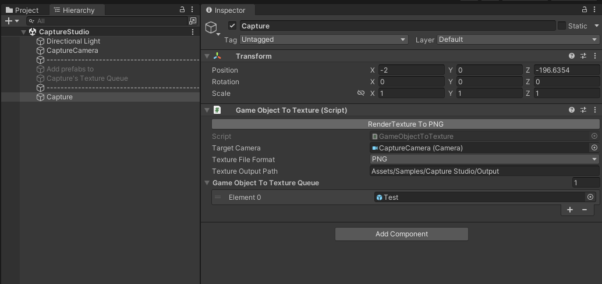

# Capture Studio

Unity 에디터에서 GameObject를 이미지 파일로 일괄 저장하는 도구입니다. 캡처할 Prefab이나 GameObject를 목록에 넣고 버튼을 누르면, 지정한 카메라의 RenderTexture를 PNG, JPG, TGA, EXR 중 원하는 형식으로 저장합니다.

<p align="center">
  
</p>

## 주요 기능

- 여러 GameObject를 등록해 한 번에 캡처
- PNG, JPG, TGA, EXR 출력 지원
- 원본 오브젝트를 건드리지 않고 복제본을 생성해 촬영
- 촬영이 끝나면 생성한 복제본을 자동 정리
- 바로 확인할 수 있는 `Capture Scene` 샘플 제공
- Unity Package Manager(UPM) 설치 지원

## 요구 사항

- Unity 2020.3 이상
- Unity 에디터 환경

> Capture Studio의 캡처 컴포넌트는 에디터 전용으로 동작합니다. 런타임 빌드에서 사용하는 용도가 아닙니다.

## 설치

### Git URL로 설치

1. Unity에서 **Window > Package Manager**를 엽니다.
2. 왼쪽 위의 **+** 버튼을 누릅니다.
3. **Add package from git URL...**을 선택합니다.
4. 아래 주소를 입력합니다.

```text
https://github.com/KALI-UM/CaptureStudio.git
```

### manifest.json에 추가

프로젝트의 `Packages/manifest.json`에 다음 항목을 추가해도 됩니다.

```json
{
  "dependencies": {
    "com.kali-um.capturestudio": "https://github.com/KALI-UM/CaptureStudio.git"
  }
}
```

## 권장 사용법: 샘플 씬 가져오기

Camera나 RenderTexture를 처음부터 설정할 필요는 없습니다. 특별한 이유가 없다면 패키지에 포함된 **Capture Scene 샘플을 가져와 사용하는 방법을 권장합니다.** 샘플에는 캡처에 필요한 Camera, RenderTexture, 테스트 Prefab이 이미 연결되어 있습니다.

1. **Window > Package Manager**에서 **Capture Studio**를 선택합니다.
2. **Samples** 탭의 **Capture Scene**에서 **Import**를 누릅니다.
3. 가져온 `CaptureStudio` 씬을 엽니다.
4. Hierarchy에서 `Capture` 오브젝트를 선택합니다.
5. `Game Object To Texture Queue`에 캡처할 Prefab을 넣습니다.
6. Inspector의 **RenderTexture To PNG** 버튼을 누릅니다.

기본 출력 경로는 `Assets/Samples/Capture Studio/Output`입니다.

## AI 코딩 에이전트로 설치하기

Codex, Claude Code 같은 AI 코딩 에이전트에는 아래 내용을 그대로 전달하면 됩니다.

```text
현재 Unity 프로젝트에 Capture Studio를 설치해줘.

1. Packages/manifest.json의 기존 dependencies는 유지한다.
2. 아래 패키지를 중복 없이 추가한다.
   "com.kali-um.capturestudio": "https://github.com/KALI-UM/CaptureStudio.git"
3. 패키지 소스 코드는 수정하지 않는다.
4. Camera나 RenderTexture를 새로 만들지 않는다.
5. 설치 후 Unity Package Manager에서 Capture Studio의
   Capture Scene 샘플을 Import하라고 안내한다.
6. 샘플 씬을 열고 Capture 오브젝트의 Inspector에서
   RenderTexture To PNG 버튼을 누르는 사용 순서를 알려준다.
```

에이전트가 수정해야 하는 항목은 `Packages/manifest.json`의 dependency 한 줄뿐입니다.

```json
"com.kali-um.capturestudio": "https://github.com/KALI-UM/CaptureStudio.git"
```

Unity가 패키지를 정상적으로 해석하면 `Packages/packages-lock.json`에도 `com.kali-um.capturestudio` 항목이 생성됩니다. 샘플 가져오기는 Unity의 Package Manager에서 진행하는 것이 가장 안전합니다. `Library/PackageCache`의 파일을 직접 복사하거나 패키지 소스를 수정하지 마세요.

## 직접 설정하기 (선택)

샘플 씬으로 해결되지 않는 구도나 출력 설정이 필요할 때만 아래 내용을 참고하세요. 일반적인 사용에는 이 과정이 필요하지 않습니다.

### 1. RenderTexture 만들기

Project 창에서 **Create > Render Texture**를 선택합니다. RenderTexture의 가로·세로 크기가 최종 이미지 해상도가 됩니다.

투명 배경이 필요하면 다음 조건도 확인하세요.

- 카메라의 **Clear Flags**를 `Solid Color`로 설정
- Background 색상의 알파 값을 `0`으로 설정
- 알파 채널을 지원하는 PNG, TGA 또는 EXR 형식 사용

### 2. 캡처용 카메라 설정하기

씬에 Camera를 만들고 앞에서 만든 RenderTexture를 Camera의 **Target Texture**에 연결합니다. 이미지 구도는 이 카메라의 위치, 회전, Projection 설정을 따릅니다.

### 3. GameObjectToTexture 추가하기

빈 GameObject를 만들고 `GameObjectToTexture` 컴포넌트를 추가한 뒤 다음 값을 지정합니다.

| 항목 | 설명 |
| --- | --- |
| `Target Camera` | 캡처에 사용할 카메라 |
| `Texture File Format` | EXR, JPG, PNG, TGA 중 저장 형식 |
| `Texture Output Path` | 프로젝트 기준 출력 폴더. 기본값은 `Assets/Samples/Capture Studio/Output` |
| `Game Object To Texture Queue` | 순서대로 캡처할 GameObject 또는 Prefab 목록 |

설정을 마쳤으면 Inspector 상단의 **RenderTexture To {FORMAT}** 버튼을 누릅니다.

## 동작 방식

Capture Studio는 등록한 GameObject마다 복제본을 만들고 원점 `(0, 0, 0)`에 배치합니다. 복제본을 하나씩 활성화하면서 카메라를 강제로 렌더링하고, Camera의 RenderTexture를 Texture2D로 읽어 파일로 저장합니다. 촬영한 복제본은 즉시 제거하며, 모든 작업이 끝나면 AssetDatabase를 새로 고칩니다.

```text
캡처 목록
  → GameObject 복제 및 비활성화
  → 하나씩 활성화
  → Camera.Render()
  → RenderTexture를 Texture2D로 변환
  → 이미지 파일 저장
  → 복제본 제거
```

## 출력 형식

| 형식 | 확장자 | 용도 |
| --- | --- | --- |
| PNG | `.png` | 무손실 이미지, 투명 배경 |
| JPG | `.jpg` | 작은 파일 크기가 필요한 이미지 |
| TGA | `.tga` | 게임 아트 파이프라인, 알파 채널 |
| EXR | `.exr` | HDR 및 부동소수점 색상 데이터 |

JPG 저장 품질의 기본값은 `95`입니다. 현재 Inspector에서는 품질 값을 따로 노출하지 않습니다.

### 캡처 결과 예시

샘플 씬의 `Test` Prefab을 PNG로 저장한 결과입니다. 이미지 크기는 Camera에 연결한 RenderTexture의 해상도를 따릅니다.

<p align="center">
  
</p>

## 사용 시 주의할 점

- `Target Camera`와 Camera의 `Target Texture`가 모두 지정되어 있어야 합니다.
- 복제본은 항상 월드 원점에 생성됩니다. 원본의 위치를 그대로 사용해야 한다면 코드를 조정해야 합니다.
- 같은 이름의 GameObject를 여러 번 캡처하면 같은 경로에 저장되어 이전 파일을 덮어쓸 수 있습니다.
- 캡처 목록에는 씬 오브젝트와 Prefab을 모두 넣을 수 있지만, 대상이 원점에서 정상적으로 보이도록 카메라 구도를 맞춰야 합니다.
- RenderTexture 해상도가 높거나 대상이 많으면 에디터가 잠시 멈출 수 있습니다. 캡처는 동기식으로 처리됩니다.

## 프로젝트 구조

```text
CaptureStudio/
├─ Editor/
│  └─ GameObjectToTextureEditor.cs
├─ Runtime/
│  └─ Scripts/
│     ├─ GameObjectToTexture.cs
│     └─ SaveTextureToFileUtility.cs
├─ Samples~/CaptureScene/
├─ package.json
└─ README.md
```

## 라이선스

[MIT License](https://github.com/KALI-UM/CaptureStudio/blob/main/LICENSE)로 배포됩니다.
